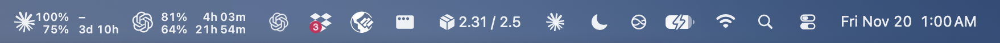

# usage

Two small macOS apps for checking usage from the menu bar.

- [UsageBar](UsageBar/) shows remaining Claude and Codex usage for the five-hour and weekly windows, with reset countdowns.
- [Dropbox Usage](dropbox-usage/) shows used and total Dropbox storage in GiB.

Inspired by [Claude Battery](https://github.com/Reebz/claude-battery) and [OpenUsage](https://github.com/robinebers/openusage). The Claude and Codex icons come from OpenUsage under its [MIT license](UsageBar/Icons/LICENSE).
